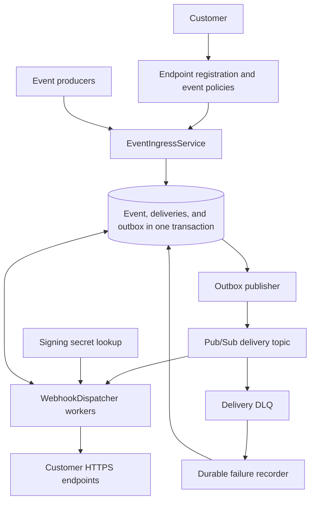

# Delivery architecture walkthrough

Implementation outline supporting the [agreed V1 specification](spec.md). The
current checkpoint includes Flask ingress, seeded routing, atomic SQLite acceptance,
and periodic outbox publication verified against the official Pub/Sub emulator.
HTTP dispatch and DLQ handling remain planned.
The lead owns these notes.

Ingress checkpoint verification: 16 tests pass using Flask's test client and
service fixtures. The original scaffold example was removed. A real Flask CLI/HTTP
smoke test submitted E1, restarted the
server against the same SQLite file, and confirmed the same delivery IDs, one
event, two pending deliveries, and two unpublished outbox rows. Partial outbox
write failure rolls back acceptance. This is lead self-review and local testing;
Publisher checkpoint verification adds nine unit tests and two real emulator
integration tests, for 27 passing tests with the emulator configured. The tests
cover independent publication, retry timing, ambiguous acceptance, a failed
publication-state commit, real HTTP ingress to A/B broker envelopes, and recovery
after creating a missing topic. A separate CLI demo observed A and B messages and
confirmed that Deliveries remain pending while their Outbox rows are published.
End-to-end customer HTTP delivery has not been exercised yet.

## Interview sequence from the supplied problem

This is a proposed rehearsal sequence for Auger's 60-minute session on a provided
laptop. The brief's actual constraints govern the session. The unfamiliar agent
and interviewer can help refine the design as it develops.

### Reach a defensible first checkpoint

1. Restate the customer outcome. Internal events must reach registered customer
   endpoints while event production continues during endpoint failures.
2. Trace one event for endpoints A and B. A returns `200`; B times out. Ask how
   success for A and retryable work for B should be represented separately.
3. State the proposed contract. Accept after durable commit, retry each endpoint
   independently, permit duplicate HTTP requests with stable delivery IDs, and
   propose unordered delivery for the first slice. Ask the interviewer whether
   ordering or a particular retry window changes the problem.
4. Agree the boundary. Seed two existing registrations and the event mapping.
   The producer retains and retries events before acceptance. Registration and
   policy CRUD belong to the external configuration system. This makes delivery
   behavior the working demonstration.
5. Introduce the broker to decouple production from dispatch. Propose Pub/Sub
   because it is familiar, with its emulator for local integration. Check Docker
   and emulator prerequisites early while discussing the contract. Timebox setup
   and report environment failures separately from application failures.
6. Ask what happens if the database commit succeeds and publishing fails. Use
   that failure to justify the transactional outbox. Commit Event + Deliveries +
   one Outbox entry per endpoint, then publish each independently. State the
   policy-availability tradeoff of doing lookup during ingress.
7. Sketch signing and untrusted destination boundaries. Use an endpoint secret
   reference, sign each attempt at send time, set a total deadline, and disable
   redirects. Explain private-address and DNS-change risks. The receiver verifies
   signatures and deduplicates effects. Production egress hardening and key
   rotation need their own qualification.
8. Agree the first feature and test. Give the agent a bounded implementation task
   with the current contracts, expected test, and concrete stopping point. Inspect
   the transaction boundary and explain the observed result to the interviewer.

The hardest decision to emphasize is the acceptance boundary and the duplicate
window around the customer's HTTP response. A managed broker supplies retries,
while our application still owns durable acceptance, delivery identity, outcome
recording, and the point at which a message is acknowledged.

### Requirement-to-design connection

| Brief requirement | Decision to explain | Evidence to show |
| --- | --- | --- |
| One or more registered endpoints | Seed existing registrations, create one Delivery per matching endpoint | E1 creates D-A and D-B |
| Events continue during unhealthy endpoints | Separate durable acceptance from asynchronous dispatch | A later event is accepted while B is retrying |
| Slow, flaky, temporarily down | Bounded HTTP attempts with broker redelivery | A completes and B records timeout then recovery |
| Permanently dead | Exhaustion reaches DLQ and is saved visibly | A failed delivery remains inspectable |
| Occasionally malicious | Destination restrictions, no redirects, bounded resources, and authenticated messages | A controlled unsafe-destination rejection and explicit hardening limits |
| Reliable delivery | Atomic outbox, stable IDs, conditional state updates, and honest duplicate semantics | Publish failure recovery and duplicate-message handling |

The brief invites discussion and a working slice. The proposed boundaries should
be said aloud and adjusted if the interviewer changes a requirement. Source code
presence, passing unit tests, emulator E2E, and production qualification are distinct
forms of evidence.

## Components and fan-out

Ingress resolves destinations and commits the event, deliveries, and one outbox
entry per destination together. Use one delivery Pub/Sub topic and its consuming
push subscription, plus a delivery dead-letter topic and recording subscription.
Workers on the same
subscription share deliveries. A separate subscription receives its own copy of
matching messages, so adding worker instances uses the existing subscription.

An event mapped to three endpoints produces three delivery messages. Every
message carries the endpoint, exact body, and signing secret reference for one
delivery. Broker message IDs are transport
metadata. Stable application IDs survive publication retries and replay.

## Handoffs and ownership

1. `EventIngressService` receives an internal platform event and resolves its
   configured destinations once. It commits the Event, frozen routing result,
   Deliveries, and their pending Outbox entries together before acceptance.
2. `OutboxPublisher` publishes those committed delivery envelopes to
   `webhook-deliveries` and records each confirmed publication independently.
3. `WebhookDispatcher` consumes one delivery envelope, retrieves its signing
   key by reference, signs and attempts the POST, records the outcome, and
   returns acknowledge or retry. It uses the queued destination and body.

Outbox writing belongs to the transaction that creates the work. The periodic
publisher is the independently invoked recovery component. These modules share
transactional storage in the first runnable slice.

V1 uses one outbox stage. There is one independently publishable entry for each
delivery. Source-event retention and retries before acceptance belong to the
producer. Ingress relies on policy availability to complete initial acceptance.

## Registration and routing

1. The existing registration system supplies versioned, customer-owned endpoints.
2. A read-only resolver supplies `billing.invoice_paid -> [A, B]` for the customer.
   Registration and policy CRUD are outside the agreed implementation scope.
3. An internal producer submits an event with a stable ID, customer, category,
   type, schema version, and payload.
4. Ingress first checks for existing acceptance. Otherwise, it obtains a versioned
   routing snapshot including each destination URL and signing secret reference,
   validates ownership, and prepares one delivery envelope per destination.
5. Save Event + snapshot + Deliveries + their Outbox entries atomically.
6. Acknowledge the producer after that commit. Repeated receipt returns the
   existing result and handles a concurrent first submission through atomic uniqueness.

The read-only resolver is now an ingress dependency. Its failure prevents initial
acceptance, and the originating service retries submission. An already accepted
duplicate can return its existing result even while the resolver is unavailable.
The dispatcher performs key retrieval and operational state checks independently
of event-routing policy evaluation.

The agreed scope begins at durable event receipt. The originating service retains
and retries its events using stable IDs until acceptance. Its business transaction
and producer outbox are outside this build's scope. Be prepared to explain that
upstream outbox if the interviewer expands the problem. Our receipt guarantee
starts at our commit.

## Outbox publication

The publisher periodically reads due outbox entries whose `published_at` is null.
After broker acceptance it conditionally sets `published_at`. A failed or
ambiguous publish leaves retryable work. A crash after publication can cause
another publish, so dispatch consumers deduplicate by application delivery identity.
Publisher retries use bounded calls and delayed, jittered scheduling.
The poller itself supplies recovery after restarts.

V1 uses one independently invoked periodic publisher, including during quiet
periods with no incoming requests. There is no persisted publication claim to
recover after a crash. A row remains unpublished until broker acceptance has
been recorded. A one-second polling interval is a proposed rehearsal setting, subject to
the latency budget and measured load. Monitor the age of unpublished entries.

Finite storage means an extended outage eventually needs admission backpressure.
Monitor pending count and oldest unpublished age, then reject new acceptance
before storage capacity is exhausted. A broker outage does not imply unlimited
ability to keep accepting events.

## One delivery invocation

1. Authenticate the broker invocation and validate its message schema.
2. Load the durable Delivery and validate customer ownership and replay generation.
3. Acknowledge an already terminal delivery or an older replay generation. For
   current work, validate the accepted envelope fingerprint before key retrieval
   or sending. Invalid envelopes return retry for DLQ diagnosis without altering
   valid delivery state.
4. Claim unresolved work transactionally with a unique lease token. A competing
   live lease returns a retry outcome so a crash cannot consume the final wakeup.
5. Check endpoint status, expiry, and destination network policy. Record terminal
   policy outcomes durably before acknowledging them.
6. Resolve the endpoint's current signing material and make one POST within the
   total deadline. Sign delivery ID + attempt timestamp + exact queued body bytes,
   using the wire format in the spec. Each retry gets a fresh timestamp and
   signature. Receiver-side verification and ID dedupe complete that contract.
7. Persist the attempt and delivery result only if the lease token and replay
   generation still match. A stale worker cannot overwrite a newer result.
8. Return acknowledge or retry to the broker adapter. A failed database commit
   returns retry. A lost response after receiver processing can cause duplicates.

Broker retry delays handle temporary unavailability between invocations. Lease
expiry makes a delivery reclaimable, while broker redelivery provides the wakeup.
The queue's retention and DLQ policy bound that recovery path. Monitor unresolved
database records so queue expiration or a broken trigger becomes visible.

## Retry and DLQ ownership

Our worker classifies customer responses and persists delivery state. The broker
adapter owns acknowledgement, redelivery configuration, retention, and DLQ setup.
For the Pub/Sub adapter, proposed initial configuration uses exponential backoff
from 10 to 300 seconds and a DLQ threshold of approximately 10 broker attempts.
These counts include failed invocations that never reached a customer POST.
Application `attempt_count` counts started send attempts, including outcomes left
unknown by a crash. These values need
qualification against the desired customer retry window.

Pub/Sub forwards exhausted messages to a configured dead-letter topic. Attach
a subscription and required IAM permissions. Its attempt threshold is
approximate. [Pub/Sub dead-letter behavior](https://docs.cloud.google.com/pubsub/docs/dead-letter-topics)

The DLQ consumer unwraps the original dispatch envelope and records failure idempotently.
Its conditional update respects replay generation and preserves success or other
terminal outcomes. While a valid worker lease remains active it retries its own
handling, then reloads state. Failure details are safe codes and identifiers.
It acknowledges only after durable recording. As a follow-up feature, a deliberate replay creates a new
generation and outbox entry after the issue is addressed, retaining delivery ID
and history. Old queue and DLQ messages cannot terminate that new generation.

Validate the accepted envelope before updating its Delivery. Unmatched or malformed
DLQ messages receive a separate durable diagnostic record keyed by original broker
message identity, then are acknowledged. Diagnostic recording is idempotent and
does not overwrite valid delivery state.

Delivery exhaustion is recorded against the individual Delivery. Invalid internal message envelopes are retained
for operational investigation without treating their contents as destinations.

V1 records and surfaces failures. Persist dead-letter time and broker reason beside
the last known HTTP outcome, then acknowledge the DLQ message. Alert on growing
failure counts or a shared failure cause. A follow-up replay feature requires extending
the minimal outbox identity and fencing old publication completions. Replay is an idempotent transaction
that checks eligibility, changes the generation and status, and inserts an outbox
entry. Resume publication through the ordinary publisher. Replay rates are bounded
to avoid flooding a recovering endpoint. Automatic recurring DLQ replay needs a
separate customer retry-window decision and a bounded cycle budget.

## Provider boundary

Keep domain operations small and explicit. Event receipt and destination
materialization share one atomic repository operation. Delivery processing needs
claim and conditional completion.
The publisher needs broker acceptance or an error. Transport adapters translate
worker outcomes into provider settlement operations.

| Selected adapter | Complete processed work | Allow another attempt |
| --- | --- | --- |
| Pub/Sub HTTP push to a function | Return `204` after committing state | Return `503`, or let an interrupted invocation time out |

Pub/Sub is the selected transport. Keep SDK calls, push-envelope parsing, and
settlement translation in its adapter and entrypoints. The application services
consume stable message references and return processing outcomes. Qualify queue
retention, acknowledgement deadlines, retry timing, and shutdown behavior for
the chosen local and cloud configurations.
[Pub/Sub push](https://docs.cloud.google.com/pubsub/docs/push)

## Isolation and security limits

Separate delivery messages provide independent retry state, but a shared broker
subscription still couples traffic. Pub/Sub push backoff can slow the whole
subscription. At scale, combine per-customer partitions with distributed send
limits and capacity budgets. A process-local semaphore only limits one process.
[Pub/Sub backoff](https://docs.cloud.google.com/pubsub/docs/push#push_backoff)

The HTTP adapter must enforce the destination and resource limits in the spec.
Registration-time DNS validation alone leaves a connection-time gap. A generic
HTTP client's connect and read timeouts also need a total deadline. Any local
demonstration of these boundaries should identify which protections it actually
implements and which require production egress configuration.

## Proposed Python code organization

Use one `webhook_service` package with a module for each application responsibility
and thin entrypoints for HTTP, scheduled publication, and broker consumption. The
same package can run locally or supply independently deployed function entrypoints.
Each delivery message is one work item, allowing multiple delivery-worker instances
to share the broker destination. Deployment boundaries and class boundaries can
be selected independently as the operational needs become clear.

| Module | Main class or function | Responsibility |
| --- | --- | --- |
| `models.py` | `Endpoint`, `RoutingSnapshot`, `Event`, `Delivery`, `DeliveryAttempt`, `DispatchEnvelope`, `OutboxEntry` | Delivery data, read-only configuration snapshots, and explicit status values |
| `ingress.py` | `EventIngressService.accept(event)` | Resolve destinations and atomically save event, deliveries, and their outbox envelopes |
| `outbox.py` | `OutboxPublisher.publish_due_batch()` | Read due unpublished entries, publish, then record acceptance or retry timing |
| `dispatcher.py` | `WebhookDispatcher.process(envelope)` | Claim delivery, retrieve signing material, sign and perform one HTTP attempt, save the outcome, and return acknowledge or retry |
| `recovery.py` | `RecoveryService.record_dead_letter(...)` | Persist exhaustion; controlled replay is a follow-up feature |
| `destination_policy.py` | `DestinationPolicy` | URL rules and current address checks integrated with actual connection enforcement |
| `signing.py` | `build_signature_headers(...)` | Sign stable delivery ID, current timestamp, and exact body bytes using endpoint material |
| `ports.py` | `Repository`, `MessageBroker`, `WebhookClient`, `EndpointResolver` | Injected contracts for transactions, publication, bounded HTTP, and read-only routing/status lookup |

The repository exposes operations matching transaction boundaries, including
`accept_event_with_deliveries`, `list_due_outbox`, `mark_published`,
`schedule_publish_retry`, `claim_delivery`, and `finish_delivery`. Each operation owns its
database transaction. Ingress persists the resolver's routing snapshot together
with the Event, Deliveries, and delivery Outbox entries. Repeated receipt reuses
committed work. External configuration can change independently of this transaction.
Delivery completion requires the current lease token. Outbox updates apply only
while `published_at` is null. A publisher crash can cause duplicate publication,
which stable delivery IDs allow the dispatcher to handle.

`MessageBroker.publish(destination, message)` confirms durable acceptance
or reports an error. `WebhookClient.post(...)` applies the destination policy to
the actual connection and returns an HTTP result or typed network failure. The
delivery service applies response classification. Inject a clock and configuration
for deterministic deadline and lease checks.

Use an injected signing-key lookup alongside these dependencies. The external
registration system owns provisioning and rotation. The queued reference names
the secret whose active key configuration is resolved at dispatch time. The
dispatcher's service account needs Secret Accessor permission on each required
secret. Validate the reference's binding to the accepted envelope before fetching
it. The local receiver fixture verifies signatures before counting
an accepted event or simulating its configured response.

Infrastructure implementations live under `adapters/`. A transactional local
database adapter using SQLite is the proposed rehearsal implementation. It stores
events, deliveries, attempt history, outbox rows, and DLQ diagnostics with
atomic commits and conditional claims. `adapters/pubsub.py` uses the Python
Pub/Sub client against the local emulator for E2E testing. Broker settlement
belongs in its consumer entrypoint. The core worker returns an acknowledge or
retry outcome. Tests can use a fake broker and HTTP client to inject duplicate
messages, ambiguous publishes, timeouts, and failures.

`EndpointResolver` reads versioned destinations and current endpoint status from
the existing configuration system. For rehearsal, an adapter returns seeded A/B
configuration. Routing resolution happens during ingress. Current status checks
at dispatch are narrow lifecycle reads, with lookup failures kept retryable.
The dispatcher receives the already selected destination in its message.

HTTP ingress now lives in the root Flask `app.py` application factory. Additional
process entrypoints can be added under `entrypoints/` as those features are built.

| Entrypoint | Calls |
| --- | --- |
| `app.py` | Flask event receipt; authorized replay can be added later |
| `publisher.py` | Periodic outbox batch publication |
| `deliver.py` | Delivery processing for one full dispatch envelope, then Pub/Sub settlement |
| `dead_letter.py` | Durable failure recording for a DLQ message, then provider settlement |

Dependency construction supplies the repository, broker, HTTP client, clock, and
configuration at these entrypoints. Application services use injected instances.
Ingress creates durable per-endpoint work, which delivery workers process independently.
All entrypoints can initially share one database and one code package. Separate
storage ownership across services would change the transaction design and needs
a separate discussion.

## Proposed local deployment and queue testing

Google Pub/Sub and its official emulator are the agreed E2E test environment.
Run application entrypoints locally with seeded A/B configuration and a
transactional database. The selected Pub/Sub adapter publishes messages through
the Python client. Emulator push subscriptions invoke the local HTTP handlers.
The supplied interview laptop's runtime prerequisites still need checking.

| Test layer | What it demonstrates |
| --- | --- |
| Unit tests with controlled dependencies | Application outcomes, duplicate handling, ambiguous publication, and deadline/lease decisions |
| E2E with the Pub/Sub emulator and local HTTP receivers | Actual application entrypoints, broker publishing, redelivery, HTTP outcomes, and DLQ consumption |

Use a local project identifier such as `auger-webhooks-local` and set
`PUBSUB_EMULATOR_HOST` explicitly for the E2E process. Bootstrap topics and
subscriptions through the client API. On this machine Docker is available, while
the Docker image pull hit a local storage I/O error. The host Pub/Sub emulator
component was installed and verified using a task-local Java 21 runtime instead.
Both routes run the official emulator. Configure a reachable push URL between the
emulator container and the local workers, then verify readiness before tests.

The emulator supports push and pull, retry policies, and dead-letter forwarding.
Resources last for its session. IAM and configurable retention differ from the
cloud service. Test worker restart with the emulator and database still running.
[Pub/Sub emulator](https://docs.cloud.google.com/pubsub/docs/emulator)

Planned topology uses the following resources.

| Topic | Consuming subscription and target |
| --- | --- |
| `webhook-deliveries` | `webhook-deliveries-worker` pushes to the delivery handler |
| `webhook-delivery-dlq` | `webhook-delivery-dlq-recorder` pushes to delivery failure recording |

The delivery subscription has its dead-letter topic and retry policy. Failures
in a DLQ recorder keep its message unacknowledged
until recording succeeds. Use isolated per-run resource names and bounded setup,
test, and teardown deadlines. Record HTTP attempts and database state as evidence.

Local receiver A returns `200`. Receiver B first delays beyond the configured
client deadline, then returns `200` on a subsequent attempt. Another case keeps B
failing until exhaustion. Real HTTP demonstrates timeout behavior. A controllable
clock makes retry-policy tests fast without long waits. A local-only transport
permits specific seeded loopback receiver ports. The production network policy
requires public destinations, and its checks have separate controlled tests.

Required E2E cases follow the real emulator path.

1. Submit one event and observe exactly two application delivery records, one
   per configured endpoint. Confirm event receipt commits the Event, snapshot,
   Deliveries, and their Outbox entries in one transaction.
   Both delivery messages contain the resolved URL, body, and signing reference.
   Verify dispatch reuses the ingress snapshot without another routing lookup.
2. A returns `200`. B first times out, then returns `200` on redelivery. Confirm
   A is complete, B has timeout and success history, and the delivery IDs persist.
   Queue duplicate deliveries may occur, so assert application idempotency.
3. B repeatedly times out. Observe broker dead-letter forwarding and a durable
   `dead_lettered` result. Use a bounded observation deadline and avoid requiring
   an exact number of broker attempts.
4. Interrupt publication before broker acceptance while preserving the database.
   After broker connectivity returns, verify the periodic publisher drains the
   pending outbox entries. An emulator restart recreates its resources, so use a
   controlled publication-connectivity failure for this case.
5. Restart a delivery worker while its database and emulator keep running.
   Verify outstanding work becomes reclaimable and is redelivered after a lease
   expires. Completed deliveries remain idempotent under message replay.
6. Receivers validate signatures with separate endpoint keys. Assert rejection
   of changed body bytes, changed signed metadata, wrong keys, missing signatures,
   and timestamps outside tolerance. Retrying B preserves its delivery ID and
   body and signs with its current attempt timestamp. A separate signature test
   uses a fixed known vector or an independent verifier to check interoperability.

Test retry settings can shorten the demonstration while using real emulator
redelivery. Validate the actual supported timing during implementation. Plan
deterministic unit tests for publish ambiguity and stale-DLQ replay races. A live
cloud test remains separate evidence for IAM, production retention, and runtime
configuration. Emulator setup and all E2E cases are pending execution.

## Design review before implementation

- The spec's service-contract section defines proposed ingress request/response
  shapes, idempotency scope, repository commit boundaries, dispatch outcomes,
  and DLQ/replay semantics. These contracts are the implementation reference.
- Correct the publish ordering in every entrypoint. Commit work and its outbox
  entry before crossing the broker boundary. An accepted publish can still repeat
  if recording its confirmation fails.
- Keep the runnable path small. Seed configuration and signing keys, use the
  proposed SQLite adapter, and run ordinary local HTTP entrypoints against the
  Pub/Sub emulator. Separate deployment of every class is unnecessary for the
  E2E checkpoint. The cloud entrypoints reuse these application services.
- Implement the agreed outgoing body and HMAC signature format in the dispatcher
  and receiver fixtures. HTTPS provides transport encryption. Verify signatures
  on real HTTP requests during E2E, including receiver rejection cases.
- Preserve acknowledgement ordering. Acknowledge only after saving a terminal
  application outcome. A live competing lease and database errors retain
  retryable work. Use conditional lease-token completion to fence stale workers.
- Keep timeout and lease settings coordinated, with shorter test settings and
  bounded waits for real Pub/Sub retry and DLQ observations.
- Check stale generation and completed state before comparing the current
  envelope fingerprint. An old replay message must not damage current work.
- Record started HTTP attempts and allow an unknown crash outcome. Distinguish
  them from Pub/Sub invocation counts and receiver-observed requests.
- Set a customer retry deadline and decide ordering semantics. The current
  proposal allows out-of-order delivery and leaves the customer retry window open.

## Proposed build checkpoints after design discussion

The user prefers building from ingress toward dispatch and finally DLQ handling.
Create only the code needed by the active checkpoint. The timing below is a
rehearsal budget, subject to the interviewer and available starter environment.

| Minutes | Feature | Main code | Observable result |
| --- | --- | --- | --- |
| 0–10 | Problem framing, concrete example, guarantees, boundary, and setup check | Read prompt and starter, sketch the flow, start emulator preparation | A small agreed slice and explicit assumptions |
| 10–22 | Durable ingress | `models.py`, `ingress.py`, transactional repository, thin event route, seeded resolver | One submission commits event + two deliveries + two pending outbox entries; duplicate reuses IDs; conflict rejects |
| 22–32 | Publication and fan-out | `outbox.py`, `adapters/pubsub.py`, periodic publisher, broker bootstrap | Both envelopes reach Pub/Sub; failed publication remains recoverable per destination |
| 32–47 | Actual HTTP dispatch | `dispatcher.py`, signing helper, bounded HTTP adapter, push entrypoint, A/B receiver fixtures | A verifies and accepts; B times out then recovers through actual emulator redelivery |
| 47–54 | Durable DLQ recording | `recovery.py`, DLQ push entrypoint | Repeated B failures exhaust retries and produce an inspectable dead-lettered record |
| 54–60 | Demonstration and review | Run the focused E2E path and inspect the important code | Explain acceptance, retries, duplicate window, observed behavior, and remaining limits |

For each feature, state a concrete expected result, establish it with a meaningful
test, implement, run the test, and inspect the relevant code and output. Tell the
agent which behavior is the active checkpoint. Expand the model and abstractions
only when a feature needs them.

Configure the delivery subscription's retry and DLQ policies during broker setup,
then add durable DLQ consumption in the last feature. Use a fresh test event for
the complete E2E demonstration. Preserve earlier successful tests as later
features extend the path.

After the first complete path works, extend crash recovery, concurrent duplicate
handling, and destination-security tests. Controlled replay and its generation
fencing are a follow-up feature after DLQ recording. Their contracts stay in the
spec, and their implementation status must be stated if the hour ends first.
Additional scale work includes per-customer capacity controls, exact scheduling,
key rotation, and production egress isolation. Choose extensions based on the
interviewer's constraints and the behavior already demonstrated.

Choose the smallest runnable checkpoint sequence with the interviewer. The local
E2E checkpoint uses the Pub/Sub emulator and real application entrypoints.
Live cloud integration needs its own verification. Local Git changes remain
uncommitted. Remote publication and deployment require task-specific direction.

## Current evidence

Design notes only. Existing problem wording is preserved. Application behavior,
timeouts, broker adapters, security controls, and cloud integration have no new
execution evidence at this checkpoint. The lead reviewed the one-outbox flow and
made its contracts explicit. Independent review has not been performed. Next
discussion starts with event receipt and the remaining product/configuration
choices in the spec.
