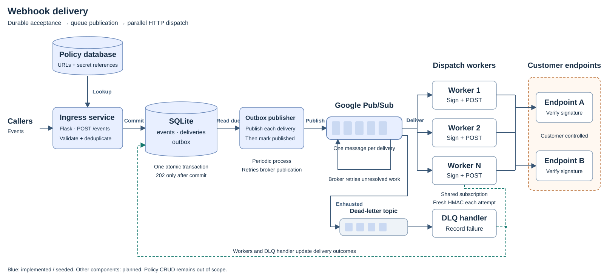

# Webhook delivery design

Agreed V1 for the 60-minute [Auger session](../PROBLEM.md). The ingress checkpoint
is implemented: Flask HTTP receipt, seeded routing, atomic SQLite acceptance,
and outbox publication through the official Pub/Sub emulator. HTTP dispatch and
DLQ handling remain planned. Numerical limits below
are configurable starting assumptions. See [running instructions](../README.md).

The ordering extension below is an agreed design update. The running checkpoint
still has the original four-field outbox and unordered publication; no schema
migration or ordered-subscription change has been applied.

## Agreed V1 flow



The internal producer and customer-controlled webhook endpoints are outside the
delivery-service boundary. Implemented features include Flask ingress, seeded
routing, atomic persistence of Event + Deliveries + Outbox, and the periodic
publisher. Worker and DLQ boxes show the target design. Ingress creates
pending delivery records; the publisher updates outbox publication state; delivery
workers update HTTP outcomes; the DLQ recorder saves exhausted delivery state.
Signing keys are resolved only by the future worker. Registration/policy CRUD and
controlled replay remain outside this implementation checkpoint.

1. `EventIngressService` validates the event, resolves the configured destinations,
   and commits the Event, Deliveries, and one pending Outbox entry per delivery
   in one transaction. It acknowledges acceptance after that commit.
2. One periodic `OutboxPublisher` publishes pending delivery messages to Pub/Sub
   and marks each outbox entry published after broker confirmation.
3. `WebhookDispatcher` workers consume delivery messages, retrieve signing keys
   by reference, sign and POST, save outcomes, and acknowledge or request retry.
4. Pub/Sub retries unresolved messages. Its DLQ consumer records exhausted
   deliveries durably. Controlled replay is a follow-up feature.

V1 has one outbox table and one publication stage. An event selecting A and B
creates two entries in that table. Each entry has independent publication state;
the proposed ordering key determines which entries may advance concurrently.
Acceptance depends on a successful policy lookup. The producer retains the event
and retries when lookup or commit fails. A separate durable receipt processor is
a future extension if acceptance must continue while policy lookup is unavailable.

## Service contracts for review

The following concrete API and method shapes are proposed for implementation.
They express the agreed flow and make its failure boundaries testable.

### Event receipt

`POST /events` accepts the following producer fields.

```json
{
  "event_id": "E1",
  "customer_id": "C1",
  "category": "billing",
  "event_type": "invoice_paid",
  "schema_version": 1,
  "occurred_at": "2026-11-17T17:00:00Z",
  "payload": {"invoice_id": "inv_42"}
}
```

The entrypoint checks the authenticated producer's authority for C1 before
acceptance or returning an existing event. Event IDs are unique within a customer.
Validate required fields, JSON shape, timestamps, configured size, and destination
count bounds before committing accepted work. The external routing lookup returns
a versioned snapshot with unique, active, customer-owned endpoint IDs, URLs, and
secret references. An unavailable lookup is different from a valid empty result.

Successful acceptance returns `202` with the event ID and delivery IDs after the
database transaction commits. It promises durable queued work. Customer HTTP
delivery can happen later. A valid empty routing result returns `202` with an
empty delivery list and records `no_targets`.

| Receipt result | Proposed HTTP response | Durable result |
| --- | --- | --- |
| First valid submission | `202` | Event + all Deliveries + all Outbox entries committed together |
| Same customer/event ID with the same content | `202` with the original IDs | Reuse original acceptance and routing snapshot |
| Same customer/event ID with conflicting content | `409` | Preserve original acceptance |
| Invalid input or configured bounds exceeded | `400` or `413` for size | Reject before acceptance |
| Missing identity or disallowed customer | `401` or `403` | Reject before acceptance |
| Routing or storage temporarily unavailable | `503` | Producer retains and retries the event |

Check duplicate acceptance before a fresh policy lookup. Use a deterministic
encoding of normalized producer fields for the content hash. Exclude server
receipt timestamps, generated delivery IDs, and current policy from that hash.
Database uniqueness resolves concurrent submissions, and the losing request
returns the committed acceptance or conflict. If the HTTP response is lost after
commit, the producer can safely repeat its event ID.

### Transaction and publication ownership

`Repository.accept_event_with_deliveries(...)` owns one transaction. It commits
the Event and immutable routing snapshot, one Delivery per unique endpoint,
and one pending Outbox entry per delivery. Partial acceptance rolls back.

`OutboxPublisher.publish_due_batch()` currently reads due entries whose
`published_at` is null. The ordering extension instead selects only the earliest
unpublished row per key, and publishes that row only when due. The immutable
envelope is stored before publication. Each broker publish
waits for acceptance within a bounded call deadline. Set `published_at` only after
that confirmation. A failed or ambiguous publish leaves recoverable work and can
move `next_publish_at` forward. A broker acceptance followed by a failed database
update can cause duplicate publication. Enforce one outbox entry per delivery.
A and B share progress constraints with a customer key; endpoint-specific keys
allow them to advance independently.

The local publisher polls once per second and schedules publication failures
five seconds later. The Google adapter uses one synchronous publish RPC per row,
a five-second deadline, and no SDK retry loop. An emulator-only inspection
subscription confirms A and B envelopes without performing HTTP delivery.

The minimal V1 outbox has no durable in-flight publication state. After a publisher
crash, its row remains unpublished and is eligible for another attempt. Concurrent
publishers can publish duplicates, which the delivery contract already tolerates.
The ordered extension requires a single active publisher for V1; overlapping
publishers must not race to publish later rows before earlier ones. Scaling
publication requires coordinated ownership per key. Failure updates only affect still-
unpublished rows. Keep outbox message contents immutable.

### Dispatch and settlement

`WebhookDispatcher.process(envelope)` returns an acknowledge or retry outcome.
The Pub/Sub HTTP entrypoint maps these to `204` and `503`. It waits for processing
and persistence to finish before returning. It uses the exact queued body bytes
for both signing and the outgoing request.

The outbound JSON envelope contains `event_id`, `type` as `category.event_type`,
`schema_version`, `occurred_at`, and `data` from the producer payload. Serialize
this envelope once at acceptance and retain its exact UTF-8 bytes. In the Pub/Sub
message it is represented as a JSON string. Decode that outer queue message and
encode its body string as UTF-8 for HTTP. Re-parsing or serializing the inner JSON
would change the signed bytes.

Load the authoritative Delivery to check ownership and generation. An older
generation or an already terminal delivery can be acknowledged. For current work,
check the accepted envelope fingerprint before claiming, retrieving keys, or
sending. An unknown schema, missing record, or inconsistent envelope returns retry
for eventual DLQ diagnosis and never becomes an outbound request. Invalid messages
must not overwrite a legitimate delivery's state.

Only the current lease token and generation can commit a result. A live competing
lease or a failed database commit returns retry. Resolve required signing material
and validate the destination before starting a send attempt. Record each started
attempt, safe outcome, duration, and key version. A crash can leave an attempt's
HTTP outcome unknown. Attempt counts describe started attempts and can differ
from the number of requests a receiver observed.

Delivery success means our service observed a `2xx` response and durably recorded
it. The recipient owns its business processing and atomic effect deduplication.
Messages can repeat and the recipient may process a request whose response we
never receive. Stable delivery IDs support that contract.

### DLQ and replay

The DLQ entrypoint decodes the wrapped original dispatch envelope and identifies
the delivery and generation. Save exhaustion before acknowledging the DLQ message.
Repeated or older-generation DLQ messages preserve existing outcomes. A late DLQ
message cannot replace success. A currently active lease requires a later recheck.
Unavailable storage keeps the DLQ message retryable.

Match the accepted envelope before changing a Delivery. An unmatched or malformed
DLQ message gets a durable diagnostic record keyed by its original broker message
identity, with a safe reason and available identifiers. It can then be acknowledged
without changing legitimate delivery state. Duplicate diagnostic recording is
idempotent. Keep raw customer payload and secret material out of diagnostic logs.

As a follow-up feature, an explicit replay request has a stable request ID. Validate authorization,
endpoint state, retained event content, and expiry. Commit the generation change,
pending delivery state, and its new outbox entry together. Repeated replay requests
reuse their recorded result. The original delivery ID and history are retained.
Before implementing replay, extend the minimal outbox identity and publication
updates to distinguish replay generations and fence old publication completions.

## Direction from our discussion

- Separate event producers from webhook dispatchers with Google Cloud Pub/Sub.
- Map each customer's `category.event_type` to registered webhook endpoints.
- Resolve destinations once at event ingress and create one delivery message for
  each event and endpoint pair.
- Use broker retries and a dead-letter queue, with application delivery records.
- Persist accepted work and an outbox entry atomically so a broker outage leaves
  recoverable work.
- Keep business logic behind a small broker interface, with Pub/Sub as the selected
  implementation.

## Agreed broker and E2E test environment

Use Google Cloud Pub/Sub for the implementation and its official local emulator
for end-to-end testing. The E2E path uses the Python Pub/Sub client, real emulator
publishing and redelivery, and local HTTP worker entrypoints and receivers.
The application owns delivery state, response classification, and idempotency.
Pub/Sub owns message redelivery and dead-letter forwarding under its configuration.

The required demonstration starts at event receipt and exercises the per-delivery
outbox, A succeeding, B timing out and being redelivered,
and a separate exhausted-delivery case reaching the DLQ handler. Controlled
broker and HTTP fakes remain useful for focused unit tests. E2E acceptance
requires the emulator path to execute successfully.

The emulator supports push subscriptions, retry policies, and dead-letter
forwarding. Its IAM, retention behavior, and session lifetime differ from the
cloud service, so cloud deployment needs separate qualification.
[Pub/Sub emulator](https://docs.cloud.google.com/pubsub/docs/emulator)

## Agreed producer boundary

The originating service owns retaining its event and retrying submission with a
stable event ID until our receipt service durably accepts it. Implementing that
service's business transaction and producer outbox is outside this build's scope.
If asked, explain how its own transactional outbox can protect the earlier handoff.

Our receipt service resolves the destination set, then acknowledges acceptance
after committing Event + frozen routing snapshot + Deliveries + their Outbox
entries together. It handles repeated submissions, rejects conflicting reuse of
an event ID, and returns failure when required routing lookup or durable acceptance
cannot complete. After that commit our service owns publication recovery, delivery,
and failure recording.
A lost receipt response can cause the producer to submit the event again.

## Agreed registration and policy boundary

The implementation focus is the delivery mechanism. An existing registration and
policy system supplies customer-owned destinations and the event-to-endpoint
mapping. Creating, updating, deleting, or editing those relationships belongs to
that system and is outside this build's scope.

Use preconfigured endpoints A and B and a read-only routing lookup for the
rehearsal. Event ingress reads a versioned routing snapshot and creates durable
per-endpoint delivery work in its acceptance transaction. Delivery execution
still checks current endpoint status and
enforces destination security. Configuration CRUD and delivery safety have
different responsibilities.

## Example to walk through

Customer C already has endpoints A and B configured. Its policy for
`billing.invoice_paid` selects both. Event E creates deliveries E-A and E-B. A accepts its POST. B times
out, then accepts a later attempt. A's successful delivery stays complete while
B retries. Another event can be accepted throughout this sequence.

## Ordering: scope, sequence, and native Pub/Sub behavior

**Default interview tradeoff: use `customer_id` as the ordering key.** All queued
deliveries for that customer form one ordered stream. If independent throughput
across its endpoints is needed, use `customer_id:endpoint_id` instead. Use stable
IDs and an unambiguous encoding; freeze the chosen key on each accepted outbox row.

| Key | Ordering scope | Consequence |
| --- | --- | --- |
| `C1` | All C1 deliveries | A failed A delivery also holds later B deliveries for C1 |
| `C1:A`, `C1:B` | Each endpoint within C1 | A and B can progress concurrently; each endpoint remains ordered |

Different keys can progress concurrently through the shared worker pool. With an
ordered push subscription, Pub/Sub permits one outstanding message per key. The
key does not reserve a dedicated worker or create a separate physical queue.
Set the native `PubsubMessage.ordering_key`, enable ordering when creating the
subscription, and publish each key through one region. Pub/Sub preserves the
order in which it receives publications for that key; it does not sort our
`sequence_number` field. [Pub/Sub ordering](https://docs.cloud.google.com/pubsub/docs/ordering)

### Generate sequence numbers in SQLite

Use one **database-wide** `INTEGER PRIMARY KEY AUTOINCREMENT` on the outbox.
Contiguous per-customer numbers are unnecessary. For example:

| Global sequence | Key | Delivery |
| --- | --- | --- |
| 1 | C1 | E1 → A |
| 2 | C1 | E1 → B |
| 3 | C2 | Another customer's delivery |
| 4 | C1 | E2 → A |
| 5 | C1 | E2 → B |

C1's order is 1, 2, 4, 5. Gaps have no meaning. No per-customer counter table is
needed. SQLite assigns the number when ingress inserts each outbox row, omitting
`sequence_number`, inside the existing `BEGIN IMMEDIATE` acceptance transaction.
SQLite serializes writers. Insert an event's endpoint deliveries in a stable order
(such as endpoint ID), finish all its outbox inserts, then commit. Concurrent event
acceptance therefore establishes a durable acceptance order. Producer `occurred_at`
and HTTP receipt timestamps remain metadata, not the ordering authority.

Check duplicate event acceptance before allocating new rows. A repeated accepted
event reuses its original delivery IDs, keys, and sequence numbers. A rolled-back
transaction leaves no accepted publication intent; its uncommitted numbers may be
reused. `AUTOINCREMENT` prevents reuse of committed row IDs after outbox cleanup.
Retain SQLite's internal sequence state. [SQLite AUTOINCREMENT](https://www.sqlite.org/autoinc.html)

### Publish the head of each stream

Select the lowest unpublished sequence for each key, then test its due time. An
earlier unpublished row blocks later rows even when its own retry time is in the
future. Never filter out delayed predecessors before deciding which row is first.

```sql
SELECT candidate.*
FROM outbox AS candidate
WHERE candidate.published_at IS NULL
  AND candidate.next_publish_at <= :now
  AND NOT EXISTS (
      SELECT 1 FROM outbox AS earlier
      WHERE earlier.ordering_key = candidate.ordering_key
        AND earlier.published_at IS NULL
        AND earlier.sequence_number < candidate.sequence_number
  )
ORDER BY candidate.next_publish_at, candidate.sequence_number
LIMIT :batch_size;
```

Publish each selected row with its saved native ordering key and wait for broker
acceptance before marking it published. Re-query stream heads after success to
advance that key. A failed or ambiguous publish retains the same row, sequence,
and key and delays its retry; other eligible keys can advance. Keep the existing
bounded calls and batch budget, and hold no database transaction across a publish.

### HTTP retries, completion, and boundaries

E2 can already be published while E1 is being dispatched. Pub/Sub gates delivery
to the worker by key, while the outbox gates publication order. Save the HTTP
outcome before acknowledging. A retry response holds later messages for that key.
The existing terminal-failure policy acknowledges recorded permanent failures;
native dead-letter forwarding can also allow progress with a failure gap. Ordered
attempts do not promise that every earlier event succeeded. DLQ forwarding is
best effort and does not preserve a complete ordered history.

Duplicate publication and redelivery remain possible. Keep delivery deduplication
and leases, and do not infer the receiver's business-effect order from a timeout.
Customer-wide ordering limits outstanding messages for that key; admission limits,
backlog limits, and stronger isolation are separate concerns. Switching key scope
requires a deliberate cutover after draining old work, since the new key has no
ordering relationship with the old one.

### Implementation and verification still needed

The code still uses the original unordered schema and subscription. Implement the
proposed schema, insert-time sequence allocation, head-of-stream query, native
publication key, and a newly created ordering-enabled subscription together.
Existing timestamp-only rows cannot prove an acceptance sequence for tied times;
use a fresh rehearsal database or an explicit legacy-backlog cutover rather than
inventing a historical ordering guarantee.

Verify concurrent acceptance, duplicate receipt reusing sequence numbers, and
rollback. Test that C1's delayed first row blocks its later rows while C2 advances;
then test the endpoint-key alternative. Exercise retries and duplicates through
the real ordering-enabled broker subscription, and qualify cloud behavior
separately from emulator behavior. Existing passing tests do not establish ordering.

## Models

### Endpoint supplied by the registration system

| Field | Meaning |
| --- | --- |
| `endpoint_id`, `customer_id` | Stable destination identity and owning customer |
| `version` | Version of the destination URL configuration |
| `url` | Validated HTTPS destination |
| `signing_secret_ref` | Reference to protected signing material |
| `status` | `active` or `disabled` |
| `created_at`, `updated_at` | Lifecycle timestamps |

The registration system owns customer authorization, changes, and endpoint
versions. Delivery execution consumes this read-only contract. Referenced versions
must remain available while deliveries use them. Check current status before each
send so disabled endpoints can cancel outstanding work. A disable racing with an
outbound request can leave that request already in progress.

### Event policy supplied by the routing system

| Field | Meaning |
| --- | --- |
| `customer_id`, `category`, `event_type` | Exact routing key, for example C + `billing` + `invoice_paid` |
| `endpoint_ids` | Set of registered destinations selected by this policy |
| `version`, `enabled` | Versioned routing decision and lifecycle state |

The readable event name is `category.event_type`. The external policy system owns
the mapping. Event ingress consumes its versioned snapshot and validates that selected
endpoints belong to the event's customer. Seed an exact-match mapping for the
example. Policy persistence, editing APIs, and rule evaluation are external to
the delivery implementation.

### Event

| Field | Meaning |
| --- | --- |
| `event_id`, `customer_id` | Stable producer identity, unique together |
| `category`, `event_type`, `schema_version` | Event contract and routing identity |
| `occurred_at`, `received_at` | Business occurrence and service receipt times |
| `payload`, `serialized_body`, `content_hash` | Immutable content, exact outbound UTF-8 JSON bytes, and conflict detection |
| `routing_snapshot`, `policy_version` | Frozen per-endpoint URL, version, and secret reference resolved at ingress |
| `routing_status` | `routed` or `no_targets`, committed at event acceptance |

A repeated event ID with identical content returns the existing acceptance.
Conflicting content under that ID is rejected. A successful receipt means the
event and its publication intent committed to durable storage.

Routing uses the versioned snapshot resolved by ingress for the first successful
acceptance. Its database transaction freezes the recipient set and endpoint
versions. Repeated event submissions reuse that set. Check an already accepted
event before requesting a new routing lookup. Concurrent first submissions are
resolved by the unique event identity and atomic acceptance transaction.
Ingress creates delivery work once from that snapshot. Missing policy or zero
active matches records `no_targets` visibly. Delivering old events to newly
registered endpoints would require a separate replay decision.

### Delivery

| Field | Meaning |
| --- | --- |
| `delivery_id`, `event_id`, `customer_id` | Stable identity linking the event to its customer |
| `endpoint_id`, `endpoint_version`, `policy_version` | Frozen destination and routing references |
| `dispatch_envelope_hash` | Fingerprint binding the queued endpoint, body, and secret reference to accepted delivery work |
| `status` | `pending`, `in_flight`, `retryable`, `succeeded`, `failed_permanent`, `dead_lettered`, `expired`, or `cancelled` |
| `attempt_count`, `last_status_code`, `last_error_code` | Started send attempts and their last known outcome, which can remain unknown after a crash |
| `lease_token`, `lease_expires_at` | Unique claim token and expiry for worker coordination |
| `expires_at`, `created_at`, `completed_at` | Retry deadline and lifecycle timestamps |
| `replay_generation` | Distinguishes a deliberate replay from old queued messages |
| `dead_lettered_at`, `dead_letter_reason` | Durable exhaustion timestamp and broker reason, separate from the last HTTP error |

Enforce uniqueness on `(customer_id, event_id, endpoint_id)`. Each HTTP attempt
has a small history record containing its attempt ID, time, duration, outcome,
and safe error code. The delivery ID remains stable across retries. A replay
increments its generation and preserves the history.

### Outbox entry

| Field | Meaning |
| --- | --- |
| `sequence_number` | Proposed global SQLite-generated primary key; only relative order within a key matters |
| `delivery_id` | Unique foreign key to the delivery record; preserves the 1:1 mapping |
| `ordering_key` | Repeated stream identifier: customer by default, optionally customer + endpoint |
| `message_json` | Serialized dispatch envelope containing destination, exact body, and signing secret reference |
| `next_publish_at` | Next due time for publishing an unpublished row |
| `published_at` | Broker acceptance observed by the publisher |

### Proposed SQLite outbox schema

The local database can be a file such as `var/webhooks.db`, shared by the local
ingress, publisher, and dispatcher processes. Events, deliveries, and outbox rows
are stored in that same database. This six-field schema is the proposed ordering
extension, not the currently executed four-field schema in
`webhook_service/adapters/schema.sql`. No separate sequence-counter table is needed.
All database timestamps below are UTC Unix milliseconds, supplied by the application.
The webhook signature timestamp uses Unix seconds as specified separately.

```sql
PRAGMA foreign_keys = ON;

CREATE TABLE outbox (
    sequence_number INTEGER PRIMARY KEY AUTOINCREMENT,
    delivery_id     TEXT NOT NULL UNIQUE REFERENCES deliveries(delivery_id),
    ordering_key    TEXT NOT NULL CHECK (length(ordering_key) > 0),
    message_json    TEXT NOT NULL,
    next_publish_at INTEGER NOT NULL,
    published_at    INTEGER
);

CREATE INDEX outbox_due_idx
    ON outbox (next_publish_at)
    WHERE published_at IS NULL;

CREATE INDEX outbox_unpublished_order_idx
    ON outbox (ordering_key, sequence_number)
    WHERE published_at IS NULL;
```

Enable foreign-key enforcement on each SQLite connection. Insert each pending row
inside the event/delivery acceptance transaction. A null `published_at` means
pending. Read due stream heads, publish, then conditionally set `published_at`. Failed
publication schedules the next due time while leaving `published_at` null.
Observe publication failures in safe logs and use Delivery creation time when
inspecting oldest pending work. Publication leases, separate status, attempt
counters, outbox audit timestamps, and generation-specific entries can be added
when later features need them. The Delivery's lease still coordinates actual HTTP
dispatch. Global sequence uniqueness already makes each `(ordering_key,
sequence_number)` pair unique, so another uniqueness constraint on that pair is
unnecessary. `ordering_key` alone is not unique. The publisher is configured with
the delivery topic. `message_json`
carries a secret reference, and the dispatcher creates the HMAC at send time.

Ingress atomically writes the Event, frozen routing snapshot, all Deliveries,
and one pending Outbox entry per destination. The publisher sends each committed
envelope to `webhook-deliveries` in sequence within its key. If A publishes and B
fails, B's outbox entry remains recoverable and blocks later entries sharing its
key. Other keys remain eligible. The first slice assumes a bounded
destination set. Large fan-out needs paginated, resumable materialization as a
future extension. Signing-key references are independent of outbox stage count.

Each delivery-topic Pub/Sub message contains a dispatch envelope with these fields.

```text
schema_version
delivery_id, event_id, customer_id, replay_generation
endpoint_id, endpoint_version, url
ordering_key: <ordering-extension metadata; not in today's code>
body: <exact outbound UTF-8 JSON bytes represented as a JSON string>
signing_secret_ref: <reference supplied by the configuration system>
```

For the extension, store the key in the immutable dispatch envelope as well as
the outbox column, and cover it with the accepted fingerprint. The sequence is
generated by the outbox INSERT and stays in that row; it need not be embedded
in `message_json` or sent to the receiver.
Set Pub/Sub's native ordering key from the saved column and validate its binding
to the envelope. The sequence chooses publication order, not a broker sort field.
These fields do not alter the exact outbound HTTP body or HMAC signing contract.

The dispatcher validates the envelope against the accepted delivery fingerprint
and generation, then uses its URL and body. It retrieves the referenced key and
generates signature headers for each HTTP attempt. Routing policy lookup happens
at ingress. The dispatcher still accesses durable delivery state for claims,
deduplication, and outcomes, and checks destination safety before connecting.

## Agreed outbound authentication contract

Each destination has its own shared signing secret, supplied by the external
registration system to both our sender and the customer's receiver. For rehearsal,
seed distinct secrets for A and B through local runtime configuration. Resolve
protected material through an injected lookup. Secret values stay out of event
messages, outbox entries, HTTP payloads, and logs. GitHub and Stripe both document
shared-secret webhook verification patterns.
[GitHub verification](https://docs.github.com/en/webhooks/using-webhooks/validating-webhook-deliveries) ·
[Stripe verification](https://docs.stripe.com/webhooks#verify-events)

The queue carries `signing_secret_ref` while signing takes place in the dispatcher.
Its runtime service account needs `roles/secretmanager.secretAccessor` on the
specific secrets it dispatches with. A reference alone supplies no authorization.
Bind each secret reference to the accepted delivery and customer, and validate
that binding before fetching secret material. Ingress and the outbox publisher
can pass the reference without permission to read its value. Local E2E uses an
injected environment-backed lookup with the same reference contract.
[Secret Manager access control](https://docs.cloud.google.com/secret-manager/docs/access-control)

Use the Standard Webhooks symmetric signing format for the outgoing contract.

```text
webhook-id: <stable application delivery ID>
webhook-timestamp: <current attempt Unix timestamp in seconds>
webhook-signature: v1,<base64 HMAC-SHA256 digest>

signed_bytes = delivery_id + "." + timestamp + "." + exact_raw_body
```

The HMAC signature is carried in the `webhook-signature` HTTP header. The event
data is carried in the request body. The outgoing request has this shape.

```http
POST /webhook HTTP/1.1
Host: b.example
Content-Type: application/json
webhook-id: D-B
webhook-timestamp: <current Unix timestamp>
webhook-signature: v1,<base64 HMAC-SHA256 digest>

{"event_id":"E1","type":"billing.invoice_paid","data":{"invoice_id":"inv_42"}}
```

The receiver reads the ID, timestamp, and signature from the headers, calculates
the expected HMAC over those signed fields and the exact raw body, and compares
the result with the supplied signature using its copy of the endpoint secret.

Use bytes for concatenation and signing. The body includes the event ID and event
type and stays identical across attempts. Generate the delivery ID in our service
using a constrained format. Its value and the timestamp cannot contain a period.
Use a cryptographically random 32-byte endpoint secret for the initial setup.
If its external representation has a `whsec_` prefix, decode the base64 suffix
before using it as the HMAC key. This contract follows the specification's
metadata, HMAC, and header conventions.
[Standard Webhooks](https://github.com/standard-webhooks/standard-webhooks/blob/main/spec/standard-webhooks.md)

The receiver verifies the signature against the raw request body with a constant-
time comparison before parsing or processing the event. It checks the attempt
timestamp, with a proposed five-minute past/future tolerance, and deduplicates by
delivery ID when committing its effect. A verified duplicate can return success.
Retrying an old event uses a fresh attempt timestamp and signature, following
Stripe's documented retry behavior. HTTPS protects the transport.
[Stripe replay protection](https://docs.stripe.com/webhooks#preventing-replay-attacks)

HMAC authenticates the signed bytes and detects changes. The JSON body is readable
to the recipient, and HTTPS/TLS supplies encryption in transit. The recipient's
HTTP stack handles TLS decryption before its application verifies the webhook.
Our agreed mechanism combines HMAC-SHA256 with HTTPS. Additional application-level
payload encryption would require its own key and wire-format contract.
[HMAC](https://www.rfc-editor.org/rfc/rfc2104) ·
[TLS](https://www.rfc-editor.org/rfc/rfc8446)

Destination versioning freezes the URL. Signing uses the endpoint's currently
active key configuration at send time so queued work can survive key rotation.
Record only a non-secret key version in attempt history. Rotation needs an overlap
contract with the receiver before an old key is retired. For the first slice,
one seeded active key per endpoint is enough to exercise signing and verification.
A failure to retrieve required signing material is retryable infrastructure work.

The internal producer's authentication to event ingress and authenticated Pub/Sub
push invocation are separate trust boundaries. The ingress entrypoint must check
the authenticated producer's authority for the supplied customer. Production
invoker identity and IAM require cloud qualification because the emulator lacks
IAM enforcement. Local test credentials are limited to the rehearsal environment.

## Guarantees and boundaries to discuss

- Accepted events survive a process restart and a temporary broker outage while
  durable storage remains available. Failed database commits receive an error.
- The running checkpoint permits unordered messages. The proposed extension orders
  publication and ordered push delivery within the selected key. Duplicates and
  redelivery still require idempotent consumers and delivery-state coordination.
- Each delivery progresses independently in application state. Shared broker and
  worker capacity still affect throughput. Strict customer isolation requires
  additional queue partitioning and distributed capacity controls.
- Retries continue within the configured deadline, broker retention, and retry
  policy. Permanent failures and exhausted deliveries remain inspectable.
- A receiver can process a POST before our worker loses the response or crashes.
  Retries carry the same delivery ID so the receiver can deduplicate effects.
- The ordering design defaults to customer-wide serialization. Customer + endpoint
  keys are the explicit alternative for independent endpoint throughput. A failure
  can block later work within either selected scope.

## Slow, flaky, and unavailable endpoints

The proposed worker makes one bounded HTTP attempt per invocation. It persists
the result and returns an outcome to the broker adapter. Broker redelivery
schedules later attempts. Disable automatic HTTP-client retries initially so
attempt counting and duplicate behavior stay explainable.

| Observation | Proposed delivery action | Broker outcome |
| --- | --- | --- |
| Receiver returns `2xx` | Persist `succeeded` | Acknowledge |
| Timeout, connection failure, `408`, `429`, or `5xx` | Persist `retryable` | Retry |
| Other `4xx` | Persist `failed_permanent` | Acknowledge |
| `3xx` | Persist configuration failure and close response | Acknowledge |
| Destination violates network policy | Persist `failed_permanent` with a safe reason | Acknowledge |
| Endpoint disabled or delivery expired | Persist `cancelled` or `expired` | Acknowledge |
| Database unavailable or result commit fails | Keep work unresolved | Retry |
| Required secret or current endpoint-state lookup unavailable | Keep work unresolved | Retry |
| Another worker holds a live lease | Avoid overlapping send and retain unresolved work | Retry |

Starting timeout example is a 2-second connect limit within an 8-second total
network deadline, a 15-second worker execution limit, a 30-second delivery lease,
and a 60-second broker acknowledgement or visibility window. The total deadline
includes DNS, TLS, headers, and any response reads. A read timeout alone does
not bound a server that continuously sends tiny chunks. Leave time to commit
the result and verify these settings against the selected runtime.

Default proposal delegates retry delays to the broker. An optional short inline
retry must share the same total deadline and delivery ID and record another
attempt. Long sleeps hold worker capacity while a destination remains down.
Exact `Retry-After` scheduling needs a broker feature or application scheduler
that supports a due time. This remains an open requirement.

## DLQ recovery policy

V1 provides durable failure recording and operational visibility. Explicit replay
after repair is a follow-up feature. The DLQ consumer records the
delivery ID, current generation, broker reason, last known attempt outcome, and
dead-letter timestamp before acknowledging the DLQ message. A database failure
leaves that message available for another handling attempt. Repeated DLQ messages
produce the same recorded outcome. Logs and alerts reference the durable record.

| Situation | Proposed recovery |
| --- | --- |
| Endpoint or our worker is repaired | Replay eligible affected deliveries with a bounded send rate |
| Delivery deadline passed or endpoint disabled | Retain the failure for inspection and apply the expiry or cancellation policy |
| Destination is blocked by network policy or message is invalid | Investigate the configuration or producer issue before replay |

The follow-up replay feature first extends outbox identity and publication updates
to distinguish generations and fence stale completions. Replay validates ownership,
endpoint state, retained content, and deadline. Its
transaction resets eligible work to `pending`, increments `replay_generation`,
and creates a delivery outbox entry. A stable replay request ID prevents a repeated
request from scheduling duplicate replay generations. The delivery ID and history
are retained. A fresh retry budget beyond the original deadline is an open product
policy. Automatic delayed replay is an optional future requirement with explicit
age and cycle limits, send-rate controls, and a stopping condition.

## Malicious destinations

The design limits what an untrusted destination can make us do. A slow response
alone does not establish malicious intent.

| Example | Proposed boundary |
| --- | --- |
| URL points to localhost, a private service, or cloud metadata | Reject non-public destinations for IPv4 and IPv6 |
| Public-looking hostname later resolves internally | Validate current DNS answers and bind the actual connection to an approved address |
| Public URL redirects into our network | Disable redirect following |
| Unsafe URL form | Accept HTTPS with a restricted port policy and reject embedded credentials |
| Request tries to escape application validation | Enforce outbound network restrictions through a controlled egress path |

URL parsing and DNS checks must be combined with connection-time enforcement.
Preserve TLS hostname verification when connecting to an approved address.
These protections follow OWASP's discussion of arbitrary external webhook
destinations and DNS changes. [OWASP SSRF guidance](https://cheatsheetseries.owasp.org/cheatsheets/Server_Side_Request_Forgery_Prevention_Cheat_Sheet.html)

Additional resource controls are our proposed service policy. Apply a total
request deadline, bounded headers and response reads, verified TLS, and limits
on registrations, event size, event rate, and simultaneous sends. Read only the
response information needed for classification and close the connection. Never
execute response content. Authenticate broker invocations and load customer
ownership from authoritative records. An endpoint-control challenge can reduce
abuse of third-party URLs, subject to the registration contract we choose.

## Acceptance walkthroughs

| Scenario | Expected behavior |
| --- | --- |
| C's `billing.invoice_paid` policy selects A and B | One event creates two distinct deliveries and two delivery messages |
| Routing lookup returns endpoint X owned by another customer | Ingress rejects the invalid routing snapshot |
| Same event is submitted twice | Ingress reuses the frozen routing result and existing deliveries |
| A succeeds and B times out | A remains complete while B retries |
| Broker unavailable after event acceptance | Pending outbox entry survives and publishes after recovery |
| Broker accepts but publisher crashes before saving acceptance | Repeated publication is safe through stable IDs |
| Worker crashes with a live lease | Redelivery remains retryable until the lease can be reclaimed |
| Receiver processes POST but response is lost | A later POST can repeat the same delivery ID |
| Destination resolves to a private address or redirects | Outbound policy prevents the prohibited request |
| Broker retry budget is exhausted | DLQ consumer durably records failure for inspection and controlled replay |
| A and B verify their signed requests | Each receiver accepts its own endpoint's valid signature |
| Body, delivery ID, or timestamp is modified | Receiver rejects the request before applying an effect |
| Wrong key, missing signature, or stale timestamp | Receiver rejects the request |
| B receives a retry | Same delivery ID and body, freshly computed attempt timestamp and signature |

## Open choices

- What retry deadline should customers get? Customer-level ordering is the starting
  design; choose endpoint-level keys if independent endpoint progress is required.
- Routing is resolved at ingress and frozen with successful acceptance. The
  external registration snapshot's consistency contract remains an integration
  detail to qualify.
- Should `404` or `410` disable an entire endpoint or fail only the current delivery?
  This draft fails the delivery and keeps endpoint disabling explicit.
- The external registration system's endpoint-control verification is a boundary
  question if the interviewer expands the scope.
- How strong must customer isolation be, and is precise `Retry-After` required?
- Which transactional database and local demonstration will fit the interview?
  Pub/Sub and its emulator are selected. Database implementation and live cloud
  deployment details remain open.
- HMAC-SHA256 signing with the documented headers and HTTPS is agreed. Timestamp
  tolerance and the production secret-rotation contract remain proposed. SQLite
  is the recommended local transactional database to keep the E2E setup small.

## Review checkpoint

The one-outbox flow, producer boundary, external configuration ownership, Pub/Sub
emulator E2E path, and send-time HMAC signing are agreed. The API shapes above
make those boundaries concrete for review. SQLite ingress and unordered publication
are implemented. The ordered schema and native Pub/Sub ordering are designed but
not implemented; the customer retry deadline and numerical limits remain proposed.
The two-stage receipt alternative is retained as an extension for acceptance
during policy outages. HTTP dispatch, DLQ handling, and their execution evidence
remain pending.
